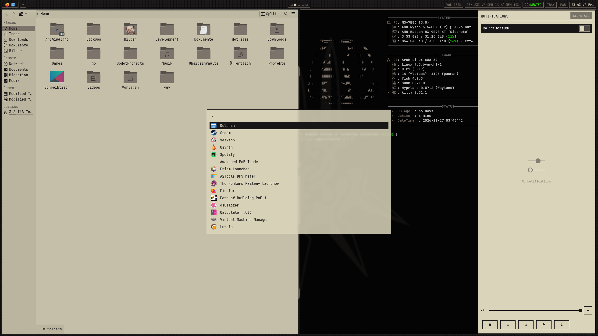

# NierRiceBohne

My Hyprland rice for Arch Linux, inspired by the look of NieR: muted browns and greys, sharp corners, boxy panels in the bar and beige menus like the ones in the game.



## What's included

| Folder | Contents |
| --- | --- |
| `hypr` | Hyprland (Lua config), Hyprpaper, Hyprlock, wallpaper, per-machine monitor files |
| `waybar` | Status bar |
| `swaync` | Notifications and control center |
| `fuzzel` | App launcher |
| `kitty` | Terminal |
| `fish` | Shell with a custom prompt and greeting |
| `fastfetch` | System info with a NieR logo |
| `cava` | Audio visualizer |
| `gtk-3.0`, `gtk-4.0` | GTK settings (dark mode, icons, cursor size) |
| `qt6ct`, `color-schemes` | Colors for Qt and KDE apps such as Dolphin |
| `sddm` | Optional login screen theme |

## Installation (fresh Arch)

Requirements: an installed Arch system with a regular user, `sudo` and an internet connection.

```bash
sudo pacman -S git
git clone https://github.com/TayronSti/dotfiles.git ~/dotfiles
cd ~/dotfiles/NierRiceBohne
chmod +x install.sh link.sh
./install.sh
```

The script updates the system, installs all packages (official repos and AUR), links the configs into `~/.config` and sets fish as the default shell. If no AUR helper is installed, it offers to build `paru`. Existing config folders are backed up first as `<name>.bak.<number>`, nothing is overwritten.

To only link the configs without installing packages:

```bash
./link.sh
```

Start Hyprland from the TTY with `start-hyprland` (not `Hyprland`), or use a login manager.

## Login screen (optional)

The SDDM theme in `sddm/` matches the lock screen. `install.sh` does not set up SDDM, because a login manager changes how the system boots.

```bash
sudo pacman -S sddm
sudo systemctl enable sddm
./sddm/test-theme.sh      # preview in a window, changes nothing
./sddm/install-theme.sh   # installs and activates the theme
```

The install script copies the theme to `/usr/share/sddm/themes/nier` and activates it in `/etc/sddm.conf.d/`. After changing anything in `sddm/nier/`, run it again. To go back to the default theme:

```bash
sudo rm /etc/sddm.conf.d/10-nier-theme.conf
```

If the login screen ever fails to show up, switch to a text console with `Ctrl + Alt + F3`, log in and run the command above.

## Per-machine setup

Monitors are machine-specific. On startup `hypr/hyprland.lua` loads `hypr/monitors_<hostname>.lua` if it exists, otherwise `hypr/monitors_default.lua`.

For a new machine:

1. Check the hostname: `cat /etc/hostname`
2. Check monitor names and modes: `hyprctl monitors`
3. Copy `hypr/monitors_default.lua` to `hypr/monitors_<hostname>.lua` and adjust it

## Keybindings (SUPER = Windows key)

| Keys | Action |
| --- | --- |
| `SUPER + Q` | Terminal (kitty) |
| `SUPER + R` | App launcher (fuzzel) |
| `SUPER + E` | File manager (Dolphin) |
| `SUPER + C` | Close window |
| `SUPER + L` | Lock screen (manual only, there is intentionally no idle lock) |
| `SUPER + M` | Exit Hyprland |
| `SUPER + F` / `SUPER + SHIFT + F` | Maximize / fullscreen |
| `SUPER + 1…0` | Switch workspace |
| `SUPER + SHIFT + 1…0` | Move window to workspace |
| `SUPER + arrow keys` | Move focus |
| `SUPER + mouse wheel` | Cycle through workspaces |
| `SUPER + left / right mouse drag` | Move / resize window |
| `SUPER + V` | Clipboard history |
| `SUPER + N` / `SUPER + SHIFT + N` | Control center / clear notifications |
| `Print` | Screenshot (whole screen) |
| `SUPER + SHIFT + S` | Screenshot (selection, saved and copied to clipboard) |
| `SUPER + SHIFT + B` | Restart Waybar |
| `ALT + TAB` | Window switcher |
| Media keys | Play/pause, next, previous (via playerctl) |

Screenshots are saved to a `Screenshots` folder inside your system's pictures folder.

## Theming notes

- **GTK apps** (e.g. pavucontrol) get dark mode from `gtk-3.0` / `gtk-4.0` and from `gsettings`, which Hyprland sets on startup.
- **Qt and KDE apps** (e.g. Dolphin) use `qt6ct-kde` with the color scheme `color-schemes/Nier.colors`. `link.sh` generates `~/.config/qt6ct/qt6ct.conf` from the template `qt6ct/qt6ct.conf`. Make changes in the template in this repo, not in the `qt6ct` app, otherwise the next run of `link.sh` overwrites them. The colors are plain RGB values in `Nier.colors`.
- **Blur** behind the launcher is set up in `hypr/layers.lua`.

## Known caveats

- **Window switcher**: `ALT + TAB` uses `hyprswitch` from the AUR. This is a fork of the original project (which is now called `hyprshell`) and works with Hyprland's Lua config (tested with version 6.1). If you prefer `hyprshell`, you need to adjust the calls in `hyprland.lua`.
- **Personal window rules**: rules for game overlays live in `hypr/games.lua` and are optional. If you don't need them, delete the file, `hyprland.lua` then skips it.
