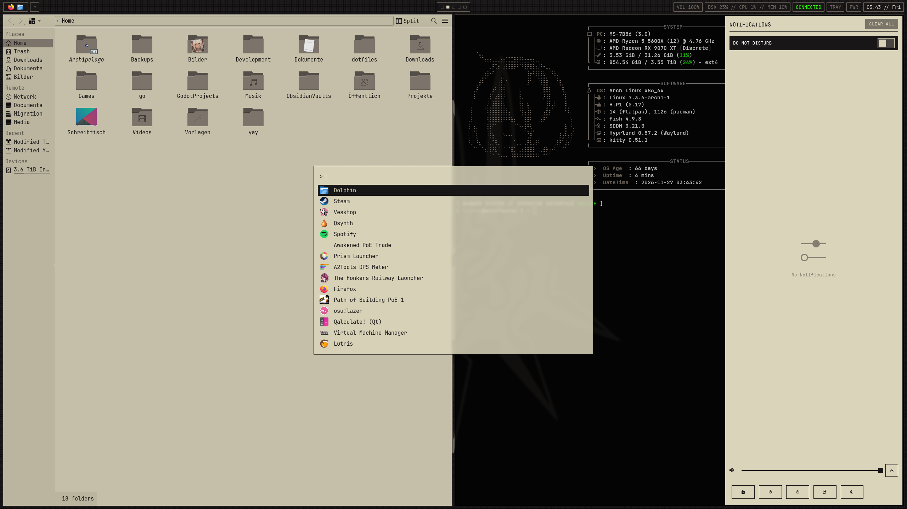

# dotfiles

My Hyprland rices for Arch Linux.

## [NierRiceBohne](NierRiceBohne/)

My current rice, inspired by the look of NieR: muted browns and greys, sharp corners, boxy panels and beige menus like the ones in the game. Comes with an install script for a fresh Arch system.

See the [NierRiceBohne README](NierRiceBohne/README.md) for installation and keybindings.

## firstRice

My first attempt at ricing, kept for reference. It is not maintained and has no install script.
